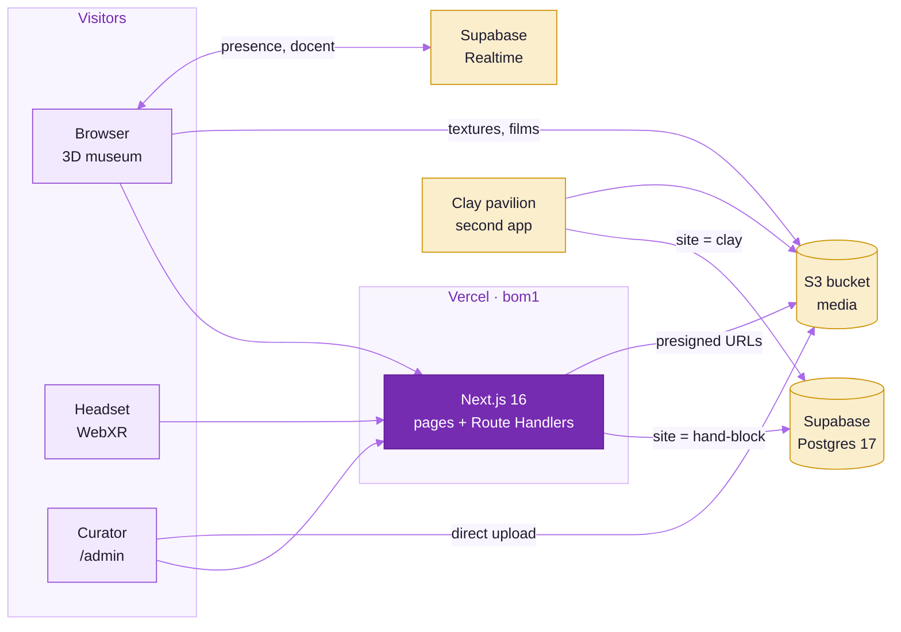
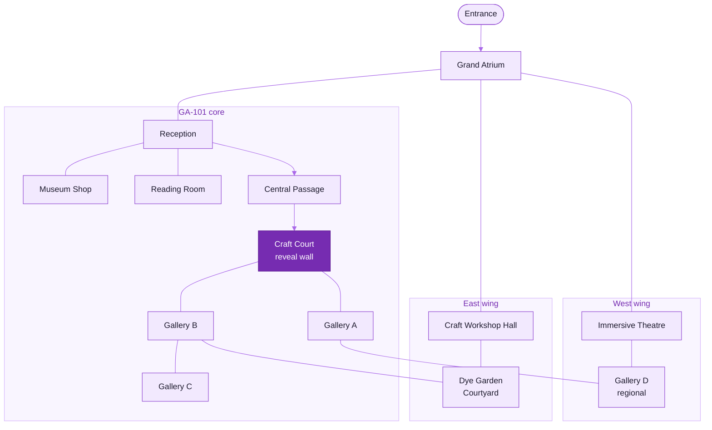
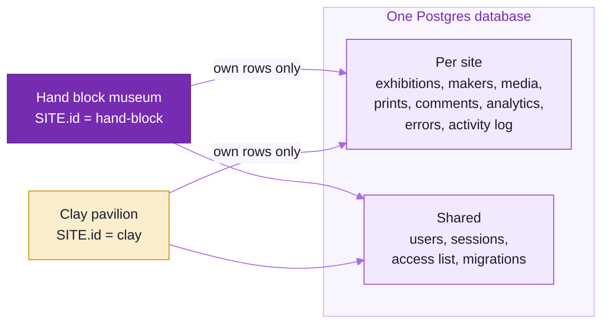
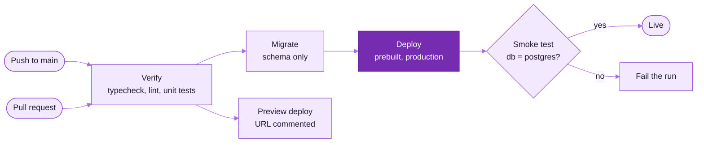

<picture>
  <source media="(prefers-color-scheme: dark)" srcset="docs/readme-kit/assets/hero-dark.svg">
  
</picture>

<p align="center">
  <picture>
    <source media="(prefers-color-scheme: dark)" srcset="https://readme-typing-svg.demolab.com?font=Plus+Jakarta+Sans&weight=600&size=20&duration=2800&pause=900&color=C090F5&center=true&vCenter=true&width=760&lines=Walk+a+museum+of+hand+block+printing;Deep+zoom+to+the+thread%2C+blocks+in+3D+and+AR;Print+a+cloth+and+hang+it+on+the+wall;Follow+a+live+docent%2C+or+step+in+with+VR">
    
  </picture>
</p>

<p align="center">
  
  
  
  
  <a href="https://hand-block-museum.vercel.app"></a>
  <a href="https://github.com/cxacraftecosystem-ui/virtual-walkthrough/actions/workflows/deploy.yml"></a>
</p>

A real-time 3D museum of India's hand block printing that runs in any modern browser, with no install and
no plug-in. Visitors walk thirteen rooms built around drawing GA-101 of the *3D Virtual Walkthrough Design
Concept Note, Rev 03*, examine textiles down to the thread, print their own cloth and join live docent
tours. Curators run every exhibition, maker, film and tour stop from one admin, and the same database
serves a second museum, the clay pavilion.

<picture>
  <source media="(prefers-color-scheme: dark)" srcset="docs/readme-kit/assets/stats-dark.svg">
  
</picture>

<picture>
  <source media="(prefers-color-scheme: dark)" srcset="docs/readme-kit/assets/divider-dark.svg">
  
</picture>

## &nbsp; What it does

<picture>
  <source media="(prefers-color-scheme: dark)" srcset="docs/readme-kit/assets/cards-dark.svg">
  
</picture>

| Feature | For | Where it lives | Read more |
|---|---|---|---|
| Walk, minimap, guided tour, click-to-walk | visitors | `src/museum/navigation`, `src/museum/tour` | [Museum guide](docs/MUSEUM.md#controls-and-url-parameters) |
| Time of day, path-traced photos, WebGPU, quality tiers | visitors | `src/museum/lighting`, `src/museum/effects` | [Graphics](docs/MUSEUM.md#graphics) |
| Deep zoom and 3D scan import | curators | `src/admin/pipeline`, `src/server/handlers/deepzoom.ts` | [Capture guide](docs/CONTENT_CAPTURE.md) |
| Print studio and Visitors' Wall | visitors, curators | `src/museum/studio`, `/api/prints` | [Backend](docs/BACKEND.md#print-it-yourself-and-the-visitors-wall) |
| Presence, live docent tours, VR and AR | visitors, staff | `src/museum/live`, `src/museum/xr` | [Live and XR](docs/MUSEUM.md#live-tours-presence-vr-and-ar) |
| Exhibitions, makers, history, trash, activity log | curators | `src/admin`, `src/server/contentStore.ts` | [API](docs/API.md) |
| Heatmaps, tour funnel, attention, CSV | admins | `src/server/handlers/curatorAnalytics.ts` | [Analytics](docs/API.md#analytics) |
| Client error reporting, optional Sentry | admins | `src/museum/utils/errorReporter.ts` | [Errors](docs/API.md#errors--monitoring) |
| Printable guide, QR labels, maker pages | visitors | `app/guide`, `app/qr`, `app/makers` | [Museum guide](docs/MUSEUM.md#pages-outside-the-3d-view) |

## &nbsp; How it works

<picture>
  <source media="(prefers-color-scheme: dark)" srcset="docs/readme-kit/assets/pipeline-dark.svg">
  
</picture>

One Next.js 16 app serves the landing page, the 3D museum, the admin and the API. The museum renders with
Three.js r186 through React Three Fiber, loads its content from `/api/content` and falls back to the
bundled `src/museum/config` when the API cannot be reached. Media goes from the browser straight to S3 with
presigned URLs, so a large film never passes through a function.



### Inside the building

The whole compound is one 62 m × 53 m × 10 m footprint on a three-by-two grid around the GA-101 spine. Visitors
arrive in the Grand Atrium, pass through reception and the narrow central passage, and meet the reveal wall
before the galleries open out.



| Graphics tier | Starts on | Shadows | Post-processing | Spotlights | Extras |
|---|---|---|---|---:|---|
| Low | small touch screens | · | · | 6 | 512 px textures |
| Medium | tablets, 4 GB devices, integrated GPUs | 2048 px, soft | native MSAA, no composer | 10 | area lights, probes with `?probes` |
| High | discrete GPUs | 4096 px, soft | AO, bloom, SMAA | 12 | |
| Ultra | flagship GPUs | 4096 px, soft | high AO, bloom, SMAA | 14 | floor reflections, 2048 px textures |

The starting tier comes from `detectInitialTier()` (pointer, screen, memory and the WebGL renderer string), and
the museum steps down a tier when it cannot hold about 32 fps. Visitors can switch tiers from the HUD at any time.

## &nbsp; Built with

<p align="center">
  <picture>
    <source media="(prefers-color-scheme: dark)" srcset="https://skillicons.dev/icons?i=nextjs,react,ts,threejs,nodejs,postgres,supabase,sqlite,aws,vercel,githubactions&theme=dark&perline=11">
    
  </picture>
</p>

| Layer | Stack |
|---|---|
| Scene | Three.js r186, React Three Fiber 9, drei 10, postprocessing, three-gpu-pathtracer, three-mesh-bvh, `@react-three/xr` 6 |
| App | Next.js 16 (App Router, Route Handlers), React 19.3, zustand 5, OpenSeadragon 6 |
| Data | `pg` against Supabase Postgres 17, or `node:sqlite` locally; AWS SDK v3 for S3 |
| Capture | glTF Transform 4 and meshoptimizer in Web Workers, DZI tiling in the browser |
| Tooling | Node.js 24, TypeScript 7 for `typecheck` and TypeScript 6 for ESLint and `next build`, ESLint 10, `node:test` via `tsx` |

Two TypeScripts are installed side by side, as the TypeScript 7 release recommends: `@typescript/native` is
TypeScript 7, which `npm run typecheck` runs, and `typescript` is TypeScript 6 (`@typescript/typescript6`),
because typescript-eslint still needs the JavaScript API that TypeScript 7 lacks. `next build` type-checks with
TypeScript 6. The typecheck script calls TypeScript 7 by its path, since both packages bring a `tsc` command and
npm links only one of them.

## &nbsp; Quick start

1. Install Node.js 24 and the dependencies.

   ```bash
   npm install
   ```

2. Start the dev server. Nothing needs configuring: SQLite (`.data/museum.sqlite`) and disk media
   (`.data/media`) are created on the first request.

   ```bash
   npm run dev
   ```

3. Open the pages.

   | Address | What |
   |---|---|
   | `http://localhost:3000/` | landing page, exhibition list |
   | `http://localhost:3000/gallery` | the 3D museum (default exhibition) |
   | `http://localhost:3000/admin` | the admin; dev login `admin@museum.local` / `admin12345` |

4. Check a change the way CI will.

   ```bash
   npm run typecheck
   npm run lint
   npm test
   npm run build
   ```

Controls: drag to look (**L** for mouse-look), **WASD** or arrows to walk, click the floor to walk there,
click a work for its details, **E** for the nearest item, **M** map, **T** time of day, **H** help.

<picture>
  <source media="(prefers-color-scheme: dark)" srcset="docs/readme-kit/assets/divider-dark.svg">
  
</picture>

## &nbsp; Two museums, one database

This app and [`virtual-walkthrough-clay`](https://github.com/cxacraftecosystem-ui/virtual-walkthrough-clay)
are two Vercel projects on one Supabase database and one S3 bucket. `src/site.ts` is the only file that
differs between the repositories by design.



| Rule | Why |
|---|---|
| `supabase/migrations/` and the SQLite mirror stay byte-identical in both repos | the runner pins each applied file by sha256 and refuses to start on a changed file |
| Every migration is additive, with constant defaults | the other app's deployed code keeps running against the new schema |
| `ADMIN_*`, `MASTER_ADMIN_EMAILS`, `LIVE_TOKEN_SECRET`, `S3_PREFIX` match in both deployments | otherwise each cold start re-syncs masters and revokes the other app's admin sessions |
| `NEXT_PUBLIC_LIVE_ROOM` differs, or is left unset | docent tokens are minted for one room only |
| Deploy hand-block first | the clay app refuses to start until `sites_aware:hand-block` is recorded |

The full contract, deploy order and env vars are in [docs/BACKEND.md](docs/BACKEND.md#two-museums-one-database).

## &nbsp; Roles and security

| Role | Admin pages | Can |
|---|---|---|
| visitor | none | favourites, guestbook and comments |
| curator | Home, Checklist, Activity, Content, Exhibitions, Makers, Media, Capture tools, Visitor prints | edit content, makers and the tour; upload media; moderate prints |
| admin | + Comments, Analytics, Errors, Users | + reset content, moderate comments, manual roles, analytics retention |
| master | Users & access | + the access list; set by `MASTER_ADMIN_EMAILS` |

| Control | How |
|---|---|
| Passwords and sessions | scrypt; 32-byte tokens stored as SHA-256 hashes; 30-day `HttpOnly`, `SameSite=Lax` cookie |
| Google sign-in | ID token checked against Google's JWKS with `jose`, `aud` pinned to `GOOGLE_CLIENT_ID` |
| Access list | elevates verified (Google) addresses only; recomputed on every sign-in and change |
| Requests | every admin route checks its role server-side; foreign `Origin` refused on writes |
| Database | TLS verified against the bundled Supabase root; RLS on with no policies, so the anon key reads nothing |
| Uploads | extension allow-list, 500 MB cap, random names, `nosniff`, no HTML or SVG; admin media URLs checked before rendering |
| Live tours | every docent message signed with ECDSA P-256 and bound to an HMAC token from the server |
| Analytics | a random session id from Web Crypto; no IP, user agent or account stored |

## &nbsp; CI and deploy



| Workflow | Runs on | Does |
|---|---|---|
| `deploy.yml` | push to `main`, pull requests, dispatch | typecheck, lint and unit tests; production migrations, a prebuilt Vercel deploy and a smoke test on `main`; a preview deploy per pull request. Pushes that change only Markdown or `docs/` skip it. |
| `ci.yml` | pull requests, dispatch | unit tests again with a Postgres 17 service, so the query-count tests check real SQL; visual regression once baselines are committed in `tests/visual/baseline` |
| `readme-check.yml` | README, `docs/` or kit changes | kit assets match `kit.json`, SVG safety rules, xmllint, image budgets, every mermaid block renders, GitHub renders the Markdown, preview PNGs |
| CodeQL | default setup | code scanning on every push |

## &nbsp; Documentation

| Question | Read |
|---|---|
| How do I add an artwork, move a wall or change the light? | [docs/MUSEUM.md](docs/MUSEUM.md) |
| How do the backend, admin, sign-in and deploy work? | [docs/BACKEND.md](docs/BACKEND.md) |
| What does each endpoint take and return? | [docs/API.md](docs/API.md) |
| How do we photograph textiles and scan blocks? | [docs/CONTENT_CAPTURE.md](docs/CONTENT_CAPTURE.md) |
| What material is the workshop still to send? | [docs/CONTENT_STILL_NEEDED.md](docs/CONTENT_STILL_NEEDED.md) |
| How is Vercel, Supabase or S3 set up? | [infra/deploy-vercel.md](infra/deploy-vercel.md), [infra/setup-supabase.md](infra/setup-supabase.md), [infra/setup-s3.sh](infra/setup-s3.sh) |
| How do visual baselines work? | [tests/visual/README.md](tests/visual/README.md) |
| How is this README built? | [docs/readme-kit/README_STYLE.md](docs/readme-kit/README_STYLE.md) |

## &nbsp; Status

<picture>
  <source media="(prefers-color-scheme: dark)" srcset="docs/readme-kit/assets/timeline-dark.svg">
  
</picture>

Production is [hand-block-museum.vercel.app](https://hand-block-museum.vercel.app), deployed from `main` by
`deploy.yml`. The workshop's own photographs, scans, films and texts are still to arrive; until they do,
items show neutral stand-ins that visitors never see labelled as missing. The list is in
[docs/CONTENT_STILL_NEEDED.md](docs/CONTENT_STILL_NEEDED.md).

<picture>
  <source media="(prefers-color-scheme: dark)" srcset="docs/readme-kit/assets/footer-dark.svg">
  
</picture>
