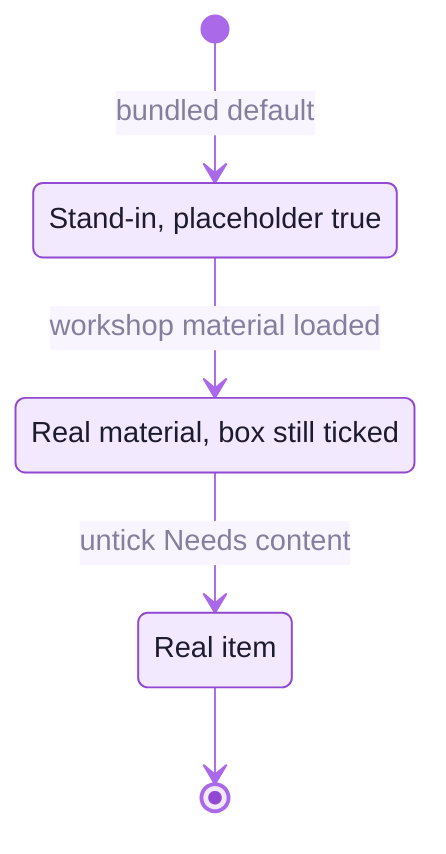

<picture>
  <source media="(prefers-color-scheme: dark)" srcset="readme-kit/assets/divider-dark.svg">
  
</picture>

# &nbsp; Content still needed from the workshop

The museum no longer tells visitors that anything is missing. Where the workshop's own material has
not arrived, an item shows a neutral, shorter version of itself, or is hidden. This list is what is
still needed to replace those stand-ins. In the admin, untick **Needs content from the workshop** on
each item once its real material is in. For makers, untick **Hidden from visitors**.

The admin's **Checklist** page lists, per item, what is still missing and exports it as a CSV for the workshop.

| What | Where in the museum | What is shown meanwhile |
|---|---|---|
| Photographs and details (artisan, region, material, technique, year) of the 5 hero textiles and the ~35 other works | Galleries A–D, craft court, atrium, reception | Generated designs, described as "made for this exhibition" |
| 3D scans of the 9 printing blocks (`block-01 … block-09`) and of the two centrepiece blocks | Hand-block tables, craft court, Gallery D | Modelled blocks |
| Curatorial text for the 6 craft panels (Regional History, Natural Dyes, Technique, Process, the salon key panel, Gallery D introduction) | Product wall, Gallery A, Gallery D | Title and illustration only |
| Interpretive text for the workshop and courtyard installations: printing tables, dye vats, block archives, wash tank, pigment station, drying lines, cloth rolls, carving bench, rinsing channel | Craft Workshop Hall, Dye Garden Courtyard | Title only |
| Species list for the dye-plant beds | Courtyard | "A planting bed for dye plants." |
| Craft-cluster locations for the India map | Gallery D map wall | Map without pins. Pins are drawn only once the map item's *Needs content* box is unticked. |
| Films: welcome, theatre feature, two process films, two "Meet the maker" portraits | Atrium, theatre, workshop | Generated films. **They carry a burned-in "Placeholder" caption and end card** (and the theatre film a speaker test), so they should be replaced, or regenerated without the caption, before launch. |
| Volumetric (Gaussian splat) recordings of a printer at work | Workshop, beside printing tables II and IV | A glowing seated figure with the card "The printer's place" |
| Maker profiles (name, cluster, biography, portrait, links), with the maker's consent | "Meet the maker" cards, `/makers/<id>`, shop links | Nothing: stand-in profiles are hidden from visitors |
| Shop: real products, makers, "Visit the maker" / "Buy" / "Online shop" links | Museum Shop | Folded textiles, no links |
| Sample book and design drawings | Reading Room | Generated from the museum's own motifs |
| Capture guide and publications (links) | Reading Room, Resources board | Only the text guide is listed |
| Final partner credit wording | Reception partners wall | Logos with "Presented by" / "In collaboration with" |

## The live database still serves the old wording

The live database was seeded with the wording from before 10 October. On 4 November 2026 `GET /api/content`
still returned it, for example "Placeholder image generated for layout and lighting calibration" in 41
descriptions. Visitors keep seeing that wording until an admin opens **Content → Reset to defaults…** for the
default exhibition, which replaces it with the current defaults ("A design made for this exhibition, in the
manner of a hand block print.").

The content version has moved from 4 (10 October) to 7 since, so read **Activity** for curator edits before
resetting. The reset keeps every item it replaces in the trash, where it can be restored. The two maker profiles
are not part of the reset: rename them or fill them in on **Makers**. Visitors cannot see them in the meantime.
