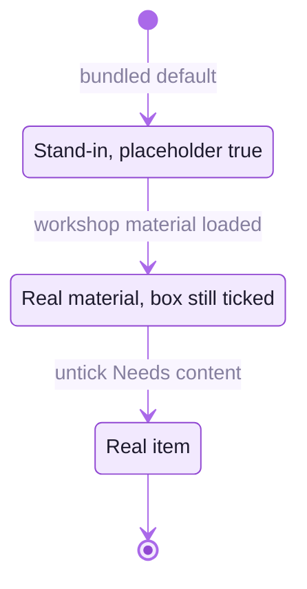

<picture>
  <source media="(prefers-color-scheme: dark)" srcset="readme-kit/assets/divider-dark.svg">
  
</picture>

# &nbsp; Content still needed from the workshop

The museum no longer tells visitors that anything is missing. Where the workshop's own material has
not arrived, an item shows a neutral, shorter version of itself, or is hidden. This list is what is
still needed to replace those stand-ins. In the admin, untick **Needs content from the workshop** on
each item once its real material is in. For makers, untick **Hidden from visitors**.

The admin's **Checklist** page lists, per item, what is still missing and exports it as a CSV for the workshop.

| What | Where in the museum | What is shown meanwhile |
|---|---|---|
| Year and real size of the workshop's 20 textiles (their photographs, makers and captions are in — `src/museum/config/workshopTextiles.ts`, images by `scripts/import-workshop-textiles.mjs`) | The 5 heroes, the reveal wall, Galleries A–D | Each fitted to its frame; no year shown |
| Optional: the workshop's own works for the 21 slots now holding open-access museum textiles (Art Institute of Chicago, Cleveland Museum of Art, Cooper Hewitt; all CC0, credited — `src/museum/config/sourcedTextiles.ts`, images by `scripts/import-sourced-textiles.mjs`) | Gallery A salon and island faces, craft court, Gallery D, atrium, reception | Documented historical Indian printed textiles, each with its museum's record and real size |
| 3D scans of the 9 printing blocks (`block-01 … block-09`) and of the two centrepiece blocks | Hand-block tables, craft court, Gallery D | Modelled blocks |
| Curatorial text for the 5 craft panels (Regional History, Natural Dyes, Technique, Process, Gallery D introduction); the salon key panel now introduces its seven fragments | Product wall, Gallery D | Title and illustration only |
| Interpretive text for the workshop and courtyard installations: printing tables, dye vats, block archives, wash tank, pigment station, drying lines, cloth rolls, carving bench, rinsing channel | Craft Workshop Hall, Dye Garden Courtyard | Title only |
| Species list for the dye-plant beds | Courtyard | "A planting bed for dye plants." |
| Craft-cluster locations for the India map | Gallery D map wall | Map without pins. Pins are drawn only once the map item's *Needs content* box is unticked. |
| Films: welcome, theatre feature, two process films, two "Meet the maker" portraits | Atrium, theatre, workshop | Generated films. **They carry a burned-in "Placeholder" caption and end card** (and the theatre film a speaker test), so they should be replaced, or regenerated without the caption, before launch. |
| Volumetric (Gaussian splat) recordings of a printer at work | Workshop, beside printing tables II and IV | A glowing seated figure with the card "The printer's place" |
| Maker profiles (name, cluster, biography, portrait, links), with the maker's consent | "Meet the maker" cards, `/makers/<id>`, shop links | Nothing: stand-in profiles are hidden from visitors |
| Shop: real products, makers, "Visit the maker" / "Buy" / "Online shop" links | Museum Shop | Folded textiles, no links |
| Sample book and design drawings | Reading Room | Generated from the museum's own motifs |
| Capture guide and publications (links) | Reading Room, Resources board | Only the text guide is listed |
| Final partner credit wording | Reception partners wall | Logos with "Presented by" / "In collaboration with" |

## What the live database holds

The live database was brought in line with the bundled content through the admin API on 20 and 21 November 2026:
the 41 frames (`scripts/sync-workshop-content.mjs`, after `import-workshop-textiles.mjs` and
`import-sourced-textiles.mjs` wrote the images), the salon's key panel and the six team pieces' descriptions.
On 21 November `GET /api/content` carried no stand-in wording in any artwork; what is still a stand-in there is
what the table above lists (the 9 blocks, 5 of the 6 panels, the 6 films and 65 of the 138 objects). The scripts
only replace an item while it is still exactly as seeded, so a curator's edit is never overwritten; running them
again changes nothing.
