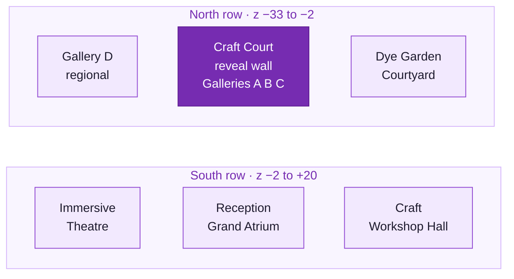
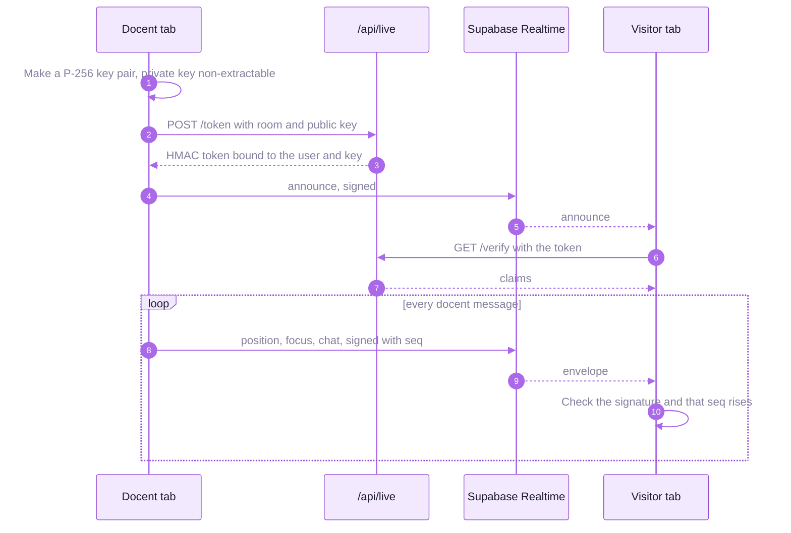

<picture>
  <source media="(prefers-color-scheme: dark)" srcset="readme-kit/assets/divider-dark.svg">
  
</picture>

# &nbsp; Museum guide

How the 3D museum is built and how to change it: the building, the content config, frames, light, graphics,
live tours and XR. Everything a curator can change at runtime is also in the admin; this guide is for the
code and the bundled defaults in `src/museum/config`.

| Section | What it covers |
|---|---|
| [Controls and URL parameters](#controls-and-url-parameters) | keys, mouse, touch and the query switches |
| [Pages outside the 3D view](#pages-outside-the-3d-view) | landing, guide, QR labels, maker pages |
| [The building](#the-building) | the v3 master plan, rooms, coordinates and dimensions |
| [Project structure](#project-structure) | where each part of the scene lives |
| [Content](#content) | adding, replacing and placing artworks, blocks and models |
| [Automatic frames](#automatic-frames) | how a frame is sized from the image |
| [Reveal wall, skylight and light](#reveal-wall-skylight-and-light) | the architectural knobs |
| [Graphics](#graphics) | time of day, probes, path tracing, arrival flight, WebGPU, tiers |
| [Live tours, presence, VR and AR](#live-tours-presence-vr-and-ar) | the social and immersive layer |
| [Validation scripts](#validation-scripts) | screenshots, interaction, load profile, visual regression |
| [Design assumptions](#design-assumptions) | what GA-101 does not specify |

## Controls and URL parameters

| Input | Action |
|---|---|
| Drag, or **L** for mouse-look with a crosshair | look around |
| **W A S D** or arrows | walk |
| Click the floor | walk there |
| Click a work or object | open its details |
| **E** | the nearest item |
| **M**, **H**, **T** | map, help, cycle the time of day |
| Touch | on-screen joystick and drag to look |

| Parameter | Effect |
|---|---|
| `?quality=low\|medium\|high\|ultra\|auto` | force a graphics tier (also in the HUD) |
| `?autostart` | skip *Enter Exhibition* once loading completes; `&tour` starts the guided tour |
| `?static` | ignore the backend: bundled content, social features hidden |
| `?lang=en\|hi\|bn` | English, Hindi or Bengali |
| `?noarrival` | skip the arrival flight (also skipped with `?autostart`, `?tour`, reduced motion, or after the first visit of the session) |
| `?nolive`, `?noanalytics` | no presence or live tours; no analytics events |
| `?renderer=webgpu` | experimental WebGPURenderer when `navigator.gpu` exists; falls back to WebGL |
| `?probes` | experimental per-zone irradiance probes, Medium and up |
| `?debug` | dev only: FPS and GPU stats, collision boxes, coordinates |
| `?quality=high&fx=0&shadows=0&area=0&ao=0&dpr=1` | dev only: profiling overrides |

Old links that put these parameters on `/` are redirected to `/gallery` with them.

## Pages outside the 3D view

| Address | What |
|---|---|
| `/` | landing page: real frames of the museum (`scripts/capture-landing.mjs`), the spaces, the published exhibitions |
| `/gallery`, `/gallery/<slug>` | the museum, default exhibition or another published one; `/e/<slug>` redirects |
| `/gallery#<kind>=<id>` | deep link to an artwork, object, exhibit, infographic, video or zone |
| `/guide?lang=` | the accessible, printable text guide, room by room |
| `/qr/<kind>/<id>` | a printable QR label that links a physical exhibit to its place in the museum |
| `/makers/<id>` | a maker's server-rendered profile (hidden while the profile is a stand-in) |
| `/admin` | the admin (see [BACKEND.md](BACKEND.md)) |

## The building

The whole compound is one cuboid, 62 m × 53 m × 10 m, on a three-by-two grid around the GA-101 spine.
Scale is **1 unit = 1 metre**; axes are +x east, +y up, **−z north**, and the entrance is at +z.



| Space | Size and height | Source |
|---|---|---|
| Main gallery (A, B, C, passage, craft court) | 20 m × 33 m, 5.6 m clear | GA-101's 30' × 60', scaled up in v3 at the client's request for "bigger and grander" |
| Reception | 10 m × 8 m, 3.8 m | GA-101's 10' × 15', lower than the gallery: compression before release |
| Central passage | 3.2 m clear, 18 m long | GA-101, partitions 4.4 m so daylight spills over |
| Reveal wall | 7.6 m × 4.4 m, 0.5 m thick, 2.2 m from the passage exit | the intentional change to GA-101 |
| Grand Atrium | x −10 to 10, z 8.5 to 20.2, 9 m | v2 wing, arrival |
| Immersive Theatre | x −31 to −10.3, z −2 to 20.2, 8 m | v2 wing, curved screen, 5.1 and 7.1 surround |
| Gallery D | x −31 to −10.3, z −33 to −2.3, 6 m | v2 wing, regional gallery and map wall |
| Craft Workshop Hall | x 10.3 to 31, z −2 to 20.2, 7 m | v2 wing, printing tables and the print studio |
| Dye Garden Courtyard | x 10.3 to 31, z −33 to −2.3, open air | v2 wing, dye vats and planting beds |
| Museum Shop, Reading Room | either side of reception | v3.1 side rooms |

All of these live in `src/museum/config/museum.ts` (`MUSEUM`, `MUSEUM.wings`), and every derived coordinate
(`KEY`, `BAY`, walls, zones, surfaces) is computed in `src/museum/config/layout.ts`, never typed by hand.

## Project structure

```
src/museum/
  config/        all content and constants: museum, layout, artworks, exhibits, infographics,
                 objects, videos, amenities, decor, frames, lighting, quality, tour, plan
  architecture/  walls, floors, ceilings and skylight, reception
  exhibits/      artworks and frame maths, hand-block tables, 3D artefacts, wall graphics
  lighting/      lighting rig, sky and sun, track lights, spot pool, night lights, zone probes
  materials/     procedural PBR textures and canvas typography
  navigation/    visitor controller, collision, click-to-walk, arrival flight
  effects/       post-processing, shader precompile, path tracer
  ui/            entry screen, HUD, info panel, minimap, help, inspection, deep zoom viewer
  media/         video screens, speakers, spatial and surround audio
  models/        procedural craft models and scene objects (GLB with procedural fallback)
  tour/          guided tour engine and pathing          trail/   "Find the motifs" family trail
  live/          presence, docent tours, chat            xr/      VR rig, AR view
  studio/        the print studio and Visitors' Wall     staff/   in-museum tools for curators
  i18n/          English, Hindi, Bengali                 a11y/    accessibility layer and settings
  share/         deep links and QR codes                 pwa/     service worker
  api/ analytics/ content/ state/                        backend client, tracker, loader, stores
app/             Next.js pages: landing, gallery, guide, qr, makers, admin, api/**/route.ts, media
src/admin/       the admin client app
src/server/      backend: database, storage, auth, content store, handlers
src/site.ts      which museum this build is
public/          artworks, models, videos, textures, audio, deepzoom, brand
```

## Content

### Add an artwork

1. Put the image in `public/artworks/` (JPG, PNG or WebP, any aspect; about 2048 px on the long edge).
2. Add an entry to `ARTWORKS` in `src/museum/config/artworks.ts`:

```ts
{
  id: 'hero-06',
  title: 'Title',
  tradition: 'Hand Block Printing',
  artisan: 'Name',
  region: '…', material: '…', technique: '…', description: '…', context: '…',
  image: '/artworks/my-textile.jpg',
  placement: { surface: 'gallery-a-outer', at: -3.4 },
  maxWidth: 1.4, maxHeight: 1.7,
  frame: 'natural-wood',
  exhibitId: 'block-06',
}
```

`artisan` is shown only when present; `physicalWidth` (metres) hangs the work at true 1:1 size instead of
fitting it; `frame` takes a style name or `{ style, matWidth }`; `exhibitId` puts a hand-block table beside it.
No geometry needs editing, and the info panel shows only the fields you provide.

### Replace an artwork

The five hero works are `hero-01` to `hero-05` (the brief asks for exactly five per tradition). Overwrite
`public/artworks/hero-0N.jpg`, or change `image:`, fill in the real metadata and set `placeholder: false`
(in the admin: untick *Needs content from the workshop*). Visitors never see a badge either way.

> [!WARNING]
> `scripts/generate-placeholders.mjs` regenerates the placeholder JPGs and overwrites files with the same names.

### Place it on a wall

`placement.surface` is a display-surface id from `SURFACES` in `config/layout.ts`; `placement.at` is the world
coordinate along that wall (z for side walls, x for cross walls); `placement.centerHeight` defaults to 1.6 m.
The accent light snaps to the nearest ceiling track.

| Surfaces | Wall |
|---|---|
| `gallery-a-outer`, `gallery-a-partition` | Gallery A perimeter and passage partition (west) |
| `gallery-b-outer`, `gallery-b-partition` | Gallery B (east, north bay) |
| `gallery-c-outer`, `gallery-c-partition` | Gallery C (east, south bay) |
| `island-<a-south\|a-north\|b\|c>-<inner\|outer>` | the free-standing double-sided wall in each bay |
| `reveal-south`, `reveal-north` | reveal wall faces |
| `product-wall`, `court-west`, `court-east` | craft court walls (craft infographics on the north wall) |
| `passage-west`, `passage-east`, `reception-west`, `reception-east` | passage and reception |
| `atrium-*`, `theatre-*`, `gallery-d-*`, `workshop-*`, `courtyard-*` | every wing wall |
| `shop-*`, `library-*` | the two side rooms |

Bay centres are `BAY.southZ` (−4.5) and `BAY.northZ` (−13.5).

### Add or replace a hand-block 3D model

1. Export the block as GLB (metres, Y up; Draco not needed) into `public/models/`, e.g. `block-01.glb`.
2. In `config/exhibits.ts` set `model: '/models/block-01.glb'` (and `modelScale` if not in metres).
3. Fill in `title`, `material`, `technique`, `artisan`, `region`, `description`; set `placeholder: false`.

The model is centred on its table, casts shadows and can be inspected (rotate, zoom, reset). A missing or broken
file falls back to the procedural block. Tables are placed with `placement: { surface, at }` like artworks.
Scans from a phone go through the admin's *3D scan import* instead: see [CONTENT_CAPTURE.md](CONTENT_CAPTURE.md).

### Deep zoom

Admin → *Capture tools* → *Deep zoom* tiles a large photograph into a DZI pyramid in the browser and sets the
artwork's `deepZoom`. Visitors open it with **Examine closely** or a double-click: OpenSeadragon with zoom, pan,
full screen, keyboard and a centimetre scale bar when `physicalWidth` is set. Demo pyramids for the hero
stand-ins: `node scripts/generate-deepzoom.mjs` → `public/deepzoom/`.

## Automatic frames

`exhibits/Artwork.tsx` and `exhibits/frameMath.ts` size every frame from the image itself.

```mermaid
%%{init: {"theme":"base","themeVariables":{"fontFamily":"Inter, ui-sans-serif, system-ui, -apple-system, Segoe UI, Roboto, Helvetica, Arial, sans-serif","fontSize":"15px","primaryColor":"#F2E9FE","primaryTextColor":"#1E1B2E","primaryBorderColor":"#9148D2","secondaryColor":"#FAEECD","secondaryTextColor":"#1E1B2E","secondaryBorderColor":"#CD9200","tertiaryColor":"#F3F1FA","tertiaryTextColor":"#1E1B2E","tertiaryBorderColor":"#A7A3BC","mainBkg":"#F2E9FE","nodeBorder":"#9148D2","nodeTextColor":"#1E1B2E","lineColor":"#AA69E9","textColor":"#857F9E","edgeLabelBackground":"#F9F5FF","clusterBkg":"#F9F5FF","clusterBorder":"#D6B6FB","titleColor":"#762CB1","noteBkgColor":"#FAEECD","noteTextColor":"#1E1B2E","noteBorderColor":"#CD9200","actorBkg":"#F2E9FE","actorBorder":"#9148D2","actorTextColor":"#1E1B2E","actorLineColor":"#AA69E9","signalColor":"#AA69E9","signalTextColor":"#857F9E","labelBoxBkgColor":"#F2E9FE","labelBoxBorderColor":"#9148D2","labelTextColor":"#1E1B2E","loopTextColor":"#857F9E","activationBkgColor":"#E7D5FE","activationBorderColor":"#9148D2","sequenceNumberColor":"#FFFFFF","transitionColor":"#AA69E9","transitionLabelColor":"#857F9E","stateLabelColor":"#1E1B2E","stateBkg":"#F2E9FE","compositeBackground":"#F9F5FF","compositeTitleBackground":"#F2E9FE","attributeBackgroundColorOdd":"#FFFFFF","attributeBackgroundColorEven":"#F9F5FF","relationColor":"#AA69E9","relationLabelBackground":"#F9F5FF","relationLabelColor":"#1E1B2E"}}}%%
flowchart LR
  I["Image loads<br/>pixel width, height"] --> F{"physicalWidth<br/>set?"}
  F -->|yes| P["Size 1:1<br/>from metres"]
  F -->|no| T["Fit inside<br/>max size minus borders"]
  P --> M["Mat = image + 2 × mat<br/>Outer = mat + 2 × frame"]
  T --> M
  M --> G["Moulding, mat board,<br/>recessed image plane"]
  G --> L["Spotlight cone<br/>and wall label"]
  classDef accent fill:#762CB1,stroke:#5F1C93,color:#FFFFFF
  class M accent
```



The aspect ratio is never changed; the image sits at the recessed mat plane with polygon offset, so there is no
z-fighting. A missing image renders an intentional *Image unavailable* card instead of breaking the scene.

| Frame style | Look |
|---|---|
| `frameless` | the cloth alone |
| `textile-panel` | a hanging textile panel |
| `thin-black`, `white` | slim gallery mouldings |
| `natural-wood`, `dark-wood` | timber mouldings |
| `brass-slim` | a slim brass edge |
| `float-walnut` | a walnut float frame |

Each style in `config/frames.ts` sets frame width and depth, mat width, recess, material, colour and mat colour.

## Reveal wall, skylight and light

| Change | Where | Notes |
|---|---|---|
| Reveal wall | `MUSEUM.revealWall` in `config/museum.ts`: `{ width: 7.6, height: 4.4, thickness: 0.5, gapFromPassage: 2.2, offsetX: 0 }` | collision, minimap, surfaces, title and wash lights all derive from it; title and intro text in `config/infographics.ts → EXHIBITION_TITLE`; keep clear circulation on both sides |
| Skylight | `MUSEUM.skylight`: `width`, `startZ`, `endZ`, `wellHeight`, `ridgeRise`, `mullionSpacing`, `beamSpacing`, `glassTint`, `glassOpacity` | direct sun enters only through the glass |
| Sun and sky | `config/lighting.ts → LIGHTING.sun`, `LIGHTING.sky`, `LIGHTING.timeOfDay` | elevation, azimuth, intensity, colour temperature, turbidity, Rayleigh, exposure |
| Track lights | `LIGHTING.track`: `colorK` (3000 K), `chromaticAdaptation`, `artworkIntensity`, `tableIntensity`, `penumbra`, `aimAngleDeg` | per artwork: `spotlight: { enabled, intensity, spread }` |
| Fill | `cove`, `skylightFill`, `ambient`, `exposure` | perimeter cove wash, diffuse daylight, hemisphere fill |

Real `SpotLight`s come from a shared pool (`lighting/SpotPool.tsx`, 6 to 14 by tier) that assigns them to the
fixtures nearest the visitor with soft cross-fades; every fixture keeps its visible track head.

## Graphics

| Feature | Where | How it works |
|---|---|---|
| Time of day | HUD sun icon, **T** | Morning, Midday, Golden hour, Dusk, Night. Dusk and night extend the sky with a blue-hour gradient, moon and stars (`lighting/nightSky.ts`); courtyard lanterns light up as spot-pool requests (`lighting/NightLights.tsx`). Only intensities and uniforms change, so no shader recompiles. |
| Zone probes | `?probes`, Medium and up, `lighting/ZoneProbes.tsx` | each zone is captured once into a small cube map, prefiltered with PMREM, and `scene.environment` cross-fades per room. Chosen over lightmap baking: no second UV set, no stale cache, about 0 ms per frame. Experimental. |
| Ray-traced photos | photo mode, `effects/PathTracer.tsx` | hold still and the view is progressively path-traced with three-gpu-pathtracer. The BVH builds in a worker from the zones currently shown. Off by default on every tier; the photo bar's **Ray-trace** toggle opts in; it is turned off where the GPU backend draws it wrongly. Scene builds time out (25 s in the worker, then a main-thread retry, 60 s and it is disabled); *Capture* waits for convergence, so the PNG is the path-traced image; any failure falls back to raster. |
| Arrival flight | `navigation/ArrivalFlight.tsx` | about 11 s over the lawns and roof lights, through the entrance, with letterbox and title card; first visit per session only. |
| WebGPU | `?renderer=webgpu`, `utils/renderer.ts` | `three/webgpu` with the TSL sky and WebGPU PMREM; the composer, probes, path tracer and GLSL patches are WebGL-only and skipped. Experimental. |
| Adaptive quality | `config/quality.ts`, `App.tsx` | `detectInitialTier()` picks the start; the museum steps down below about 32 fps. |

| Tier | Shadows | Composer | Spot pool | Texture size | Floor reflections |
|---|---|---|---:|---:|:---:|
| Low | · | · | 6 | 512 | · |
| Medium | 2048, soft | · (native MSAA) | 10 | 1024 | · |
| High | 4096, soft | AO, bloom, SMAA | 12 | 1024 | · |
| Ultra | 4096, soft | high AO, bloom, SMAA | 14 | 2048 | ✓ |

## Live tours, presence, VR and AR



| Feature | How |
|---|---|
| Presence | other visitors appear as soft silhouettes with a name tag, sent at about 5 Hz while moving; at most 40 drawn, only the orb beyond 14 m, nothing beyond 32 m. Needs `NEXT_PUBLIC_SUPABASE_URL` and `NEXT_PUBLIC_SUPABASE_ANON_KEY`; hidden when Realtime is not reachable. |
| Live docent tours | curators and admins get **Start live tour**. Joined visitors follow the docent (walk nearby, fade-teleport when far), see a ring on what is being shown, chat (rate-limited, filtered, mutable) and raise a hand. Protocol and threat model: [API.md](API.md#live-guided-tours--presence). |
| VR | **Enter VR** when `immersive-vr` is supported: 1:1 scale, teleport arc checked against walls, 30° snap turn, trigger to select, world-space info card, comfort vignette; post-processing pauses while presenting. |
| AR | inspection viewer → **View in your space**: WebXR `immersive-ar` hit-test placement on Android Chrome, AR Quick Look with a runtime USDZ on iOS and iPadOS; hidden elsewhere. |
| Staff mode | signed-in curators get in-museum placement and tour-stop tools (`src/museum/staff/`), loaded as a separate chunk only for staff. |

## Validation scripts

These need Chrome and a running server; CI runs the unit tests, the Postgres query counts and visual regression.

```bash
node scripts/screenshots.mjs http://localhost:3000 auto
node scripts/interaction-test.mjs http://localhost:3000
node scripts/load-profile.mjs http://localhost:3000 medium --json=scripts/out/load.json
node scripts/live-presence-test.mjs http://localhost:3000
node scripts/xr-emulator-test.mjs http://localhost:3000
npm run optimize:assets
npm run test:visual -- http://localhost:3000
```

| Script | Checks |
|---|---|
| `screenshots.mjs` | the demo path and every wing, with fps, into `scripts/out/` |
| `interaction-test.mjs` | walking, collision, click to panel, 3D inspection |
| `load-profile.mjs` | load time, long tasks, transfer by type |
| `live-presence-test.mjs` | presence and a live docent tour across two browsers |
| `optimize:assets` | meshopt and WebP GLBs into `public/models/opt`, WebP artwork variants, then a render check |
| `test:visual` | screenshots against `tests/visual/baseline` ([tests/visual/README.md](../tests/visual/README.md)) |

## Design assumptions

What GA-101 and the concept note leave open, and what the build chose:

| Topic | Choice |
|---|---|
| Scale | v3 scales GA-101's plan to 20 m × 33 m (client request) and keeps its organisation: passage, Galleries A, B and C either side, reveal wall and craft court at the far end |
| Heights | gallery 5.6 m clear, reception 3.8 m (compression, then release), partitions 4.4 m so daylight spills over |
| Passage | 3.2 m clear, 18 m long up the axis |
| Reveal wall | added on purpose; not in GA-101 |
| Bays | each side bay has a free-standing double-sided island wall |
| Benches | two per island bay facing the island, two in the craft court |
| Hand-block tables | beside the hero works |
| Mounting height | 1.6 m to the centre, as the brief specifies |

<picture>
  <source media="(prefers-color-scheme: dark)" srcset="readme-kit/assets/footer-dark.svg">
  
</picture>
